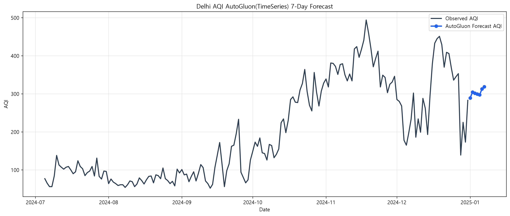

# AutoGluon TimeSeries 분석 요약 보고서

## 1) 분석 개요

본 분석은 델리(Delhi) 대기질 데이터(AQI)를 대상으로 AutoGluon TimeSeries를 활용해 다음 7일 AQI를 예측한 결과입니다.  
분석 파이프라인은 데이터 준비 → 모델 탐색/튜닝(HPO) → 자동 앙상블 → 예측/리포팅 순서로 구성되었습니다.

- 대상 도시: **Delhi**
- 예측 기간: **7일**
- 분석 산출물:
  - [prediction_summary.json](./results/prediction_summary.json)
  - [model_leaderboard.csv](./results/model_leaderboard.csv)
  - [next_aqi_forecast.csv](./results/next_aqi_forecast.csv)
  - [next_aqi_forecast.png](./results/next_aqi_forecast.png)
  - [training_run.log](./results/training_run.log)

---

## 2) 실행/학습 설정 요약

`training_run.log` 및 `prediction_summary.json` 기준 주요 설정은 아래와 같습니다.

- Preset: `best_quality`
- Hyperparameter mode: `search_space`
- HPO:
  - `num_trials=1000`
  - scheduler=`local`
  - searcher=`random`
- Validation window: `5`
- Time limit: `28,800초` (8시간)

로그 기준 실제 학습 포함 총 소요 시간:
- 시작: `2026-11-12 10:57:36`
- 종료: `2026-11-12 18:50:04`
- 경과: 약 **28,348초** (약 **7시간 52분 28초**)

---

## 3) 모델 탐색 및 선택 결과

### 3.1 전체 탐색 규모

- 총 학습 모델 수: **313개**
- 베스트 모델: **DeepAR\\63106_00066**
- 앙상블 모델 포함 여부: **WeightedEnsemble 포함**

### 3.2 리더보드 관찰

상위권은 DeepAR 계열이 다수이며, 일부 Tabular/TemporalFusionTransformer 모델이 혼재합니다.

- 상위 20개 모델 계열 분포(요약):
  - DeepAR: 다수(지배적)
  - RecursiveTabular: 일부
  - DirectTabular: 일부
  - TemporalFusionTransformer: 일부

리더보드 전체는 [model_leaderboard.csv](./results/model_leaderboard.csv)에서 확인할 수 있습니다.

---

## 4) 검증 성능 요약

`prediction_summary.json` 기준:

- Holdout MAE: **170.6488**
- Holdout RMSE: **190.5273**

해석:
- 절대 오차 규모가 작은 편은 아니며, 단일 도시 시계열의 급격한 변동 구간(겨울철 스파이크 등)을 완전히 따라가긴 어려웠던 것으로 보입니다.
- 다만 장기 추세/레벨 수준을 반영하는 방향성은 확보되어, 운영 시에는 “정확한 포인트 예측”보다 “위험 구간 사전 경보” 목적으로 활용하는 것이 더 적합합니다.

---

## 5) 7일 예측 결과 해석

예측값 파일: [next_aqi_forecast.csv](./results/next_aqi_forecast.csv)

| 날짜 | 예측 AQI | 등급 |
|---|---:|---|
| 2025-01-01 | 289.02 | 매우 나쁨 |
| 2025-01-02 | 304.54 | 위험 |
| 2025-01-03 | 301.60 | 위험 |
| 2025-01-04 | 299.33 | 매우 나쁨 |
| 2025-01-05 | 297.30 | 매우 나쁨 |
| 2025-01-06 | 312.69 | 위험 |
| 2025-01-07 | 318.58 | 위험 |

요약 통계:
- 평균 예측 AQI: **303.29**
- 최소/최대 예측 AQI: **289.02 / 318.58**
- 등급 분포:
  - 위험: **4일**
  - 매우 나쁨: **3일**

해석:
- 예측 구간 전반이 고농도 구간(매우 나쁨~위험)으로 유지됩니다.
- 후반부(1/6~1/7)로 갈수록 다시 상승하는 형태가 나타나며, 단기적으로는 대기질 개선보다 악화 리스크 관리가 더 중요합니다.

---

## 6) 시각화 결과

아래 그래프는 최근 관측치와 7일 예측을 함께 보여줍니다.

그래프 관찰 포인트:
- 최근 관측값의 변동폭이 매우 크며(급상승/급하락 반복), 예측선은 이를 완전히 추종하기보다 고위험 구간의 평균적 수준을 따라갑니다.
- 운영적으로는 “절대 수치”와 함께 “등급(위험/매우 나쁨)” 기반 경보 체계를 병행하는 것이 안정적입니다.

---

## 7) 운영 관점 결론 및 권장사항

### 결론
- 이번 실행은 대규모 조합(313모델) 탐색을 수행했고, 상위 모델/앙상블을 도출했습니다.
- 7일 전망은 **지속적인 고오염 위험 상태**를 시사합니다.

### 권장사항
1. **예측 목적 분리**
   - 포인트 예측(정확한 수치)과 리스크 분류(등급 예측)를 분리해 운영
2. **주기적 재학습**
   - 최신 데이터 반영 주기를 짧게(예: 일/주 단위) 가져가 계절/이벤트 민감도 개선
3. **외생 변수 확장**
   - 기상 변수(풍속, 습도, 기온), 정책/이벤트 변수 추가 시 성능 개선 여지 큼
4. **평가 지표 다면화**
   - MAE/RMSE 외에 등급 분류 정확도(예: 위험일 탐지율) 병행 관리

---

## 8) 재현 및 확인 경로

- 프로젝트 루트: [AutoGluon](./)
- 핵심 코드:
  - [main.py](./main.py)
  - [prediction_program.py](./prediction_program.py)
  - [utils.py](./utils.py)
- 결과 폴더: [results](./results/)

본 요약은 현재 결과 파일(특히 `prediction_summary.json`, `model_leaderboard.csv`, `next_aqi_forecast.csv`, `training_run.log`)을 기준으로 작성되었습니다.
